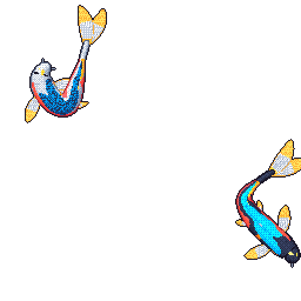

# Aniruth Karthik

Computer Science student with hands-on experience in Go, C++, Python, TypeScript, and distributed systems. Skilled in architecting backend pipelines, building AI infrastructure, and engineering low-latency simulation engines and developer tooling. Exposure to reinforcement learning, graph neural networks, static binary analysis, and event-driven microservices. Active open-source contributor with code merged in projects like Excalidraw and DoltgreSQL. Strong interest in Systems Programming, AI Infrastructure, Distributed Systems, and High-Performance Computing.

  

[linkedin](https://www.linkedin.com/in/aniruthkarthik) · [github](https://github.com/AniruthKarthik) · [gmail](mailto:aniruthkarthik10@gmail.com)

