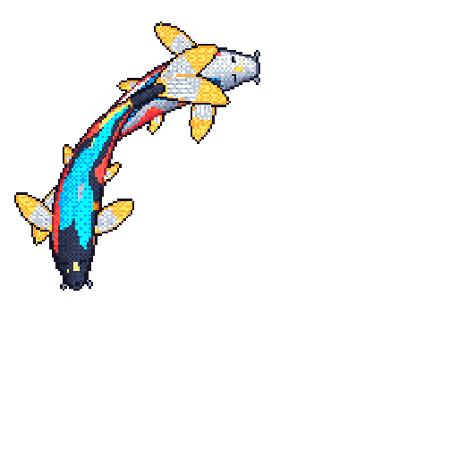

# Aniruth Karthik

Most of my projects start with a random thought: "Wouldn't it be cool if I built this?"

I mostly work with Go, Python, and C++, and sometimes Java. I've worked on projects involving backend pipelines, AI infrastructure, low-latency simulation engines, neural networks, workflow orchestration, and microservices. I also contribute to open source whenever I find time. AI and backend systems are what I spend most of my time on without getting bored.

  
  &nbsp;&nbsp;&nbsp;&nbsp;
  
  &nbsp;&nbsp;&nbsp;&nbsp;
  

[linkedin](https://www.linkedin.com/in/aniruthkarthik) · [gmail](mailto:aniruthkarthik10@gmail.com)

